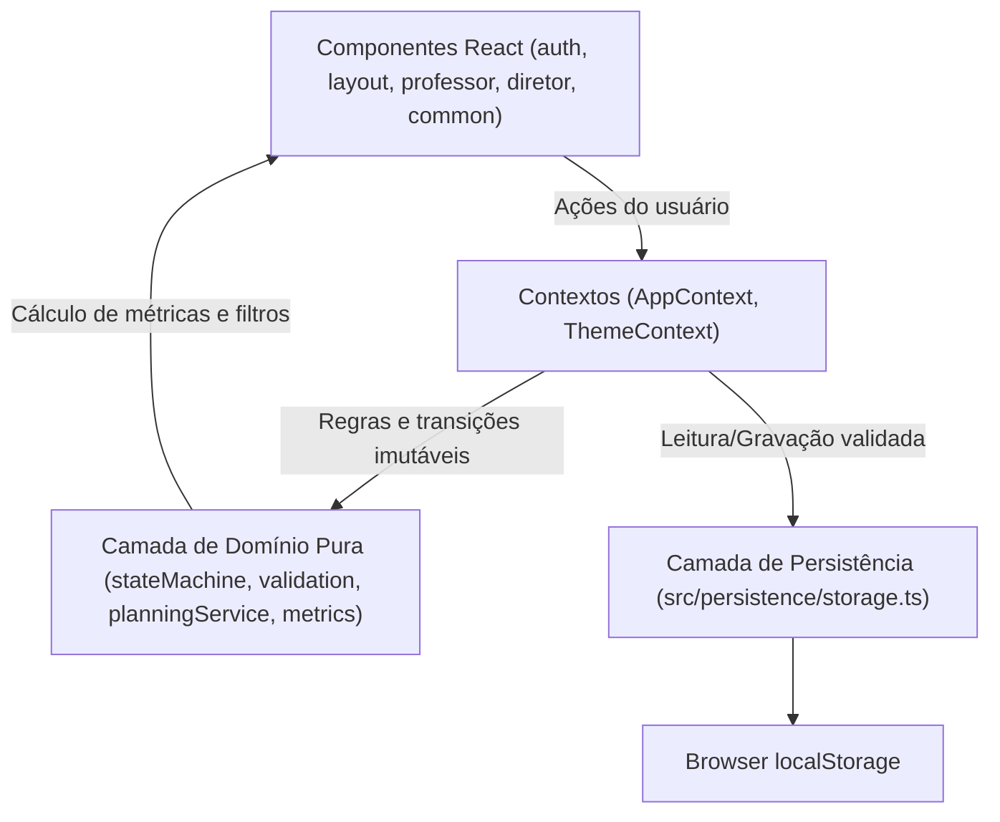

# Arquitetura — Planejamento Pedagógico Web V2

## 1. Visão geral

A aplicação é uma Single Page Application (SPA) em **React 18 + TypeScript 5 + Vite 8 + Tailwind CSS 3**, executada 100% localmente no navegador, com persistência demonstrativa em `localStorage`.

Na V1, regras de negócio, validações, manipulação de `localStorage`, cálculo de indicadores e interface ficavam fortemente acoplados dentro dos componentes React. Na V2, a arquitetura foi evoluída — sem reescrita desnecessária nem frameworks extras — para separar claramente **domínio puro**, **persistência**, **gerenciamento de estado** e **interface**.

## 2. Estrutura de diretórios

| Pasta / Arquivo | Responsabilidade |
|---|---|
| `src/types/index.ts` | Contratos TypeScript de entidades, formulários, validação e resultados de operação/persistência. |
| `src/models/auth/users.model.ts` | Interface `Usuario` dos perfis fictícios. |
| `src/data/initialData.ts` | Perfis fictícios, 3 planejamentos demonstrativos coerentes, `criarEstadoInicial()` e listas de opções. |
| `src/domain/stateMachine.ts` | Mapa explícito de transições válidas e funções de permissão por perfil e status. |
| `src/domain/validation.ts` | Regras únicas de validação (rascunho, envio completo, campo isolado e feedback da direção). |
| `src/domain/planningService.ts` | Operações de negócio puras e imutáveis sobre `AppState` + `verificarIntegridadeEstado`. |
| `src/domain/metrics.ts` | Cálculo puro de indicadores da direção, progresso do professor, estatísticas do perfil e filtros/ordenação. |
| `src/persistence/storage.ts` | Serialização, desserialização validada, migração V1 -> V2, modo proteção contra corrupção e erros de cota. |
| `src/context/AppContext.tsx` | Orquestra estado reativo, referência atualizada (`estadoRef`), chamadas ao domínio e persistência síncrona antes de confirmar sucesso. |
| `src/context/ThemeContext.tsx` | Gerencia tema claro/escuro com leitura/gravação segura no `localStorage`. |
| `src/utils/dateHelpers.ts` | Cálculo e formatação segura de quinzenas, meses e datas ISO sem gerar `NaN`. |
| `src/components/common/` | Componentes reutilizáveis acessíveis (`Modal`, `ConfirmDialog`, `Input`, `Select`, `Textarea`, `Button`, `Card`, `Badge`, `StatusBadge`, `HistoricoTimeline`, `PersistenceBanner`, `ProfileModal`). |
| `src/components/auth/` | `LoginScreen.tsx` — seleção de perfil simulado com aviso de demonstração. |
| `src/components/layout/` | `Header.tsx` — ano letivo, alternância de tema, notificações locais e troca rápida de perfil. |
| `src/components/professor/` | `ProfessorDashboard.tsx`, `FormularioPlanejamento.tsx`, `VisualizadorPlanejamento.tsx`. |
| `src/components/diretor/` | `DiretorDashboard.tsx`, `PaginaRevisao.tsx`. |

## 3. Decisões arquiteturais

1. **Funções puras na camada `src/domain/`:**
   - Recebem o estado atual e parâmetros e devolvem um resultado tipado (`ResultadoOperacao`), sem tocar em DOM, `toast` ou `localStorage`.
   - Permitem testar regras de negócio diretamente com Vitest (análogo a testar serviços Python/Pydantic com `pytest` sem subir servidor HTTP).
2. **Persistência antes da confirmação visual:**
   - Na V1, o salvamento ocorria em um `useEffect` assíncrono que ignorava falhas.
   - Na V2, `AppContext.persistirEAtualizar` executa `salvarEstadoStorage(proximoEstado)` antes de atualizar o estado e disparar `toast.success`. Se a gravação falhar (ex.: `QuotaExceededError`), a interface exibe erro real e preserva os dados digitados no formulário.
3. **Sem biblioteca externa de estado (Redux/Zustand) ou validação (Zod/Yup):**
   - O escopo demonstrativo é perfeitamente atendido por React Context + funções puras TypeScript, mantendo o projeto enxuto e compreensível.
4. **Ref `estadoRef` para evitar stale closures:**
   - Operações consecutivas dentro do mesmo ciclo de eventos sempre leem `estadoRef.current` em vez de depender de uma captura antiga da closure do render.

## 4. Limitações estruturais conhecidas

- Sem backend, autenticação real ou controle de acesso no servidor.
- Uso simultâneo em múltiplas abas do mesmo navegador não possui sincronização entre abas (`storage` event sync não foi adicionado intencionalmente para não simular infraestrutura multiusuário).
