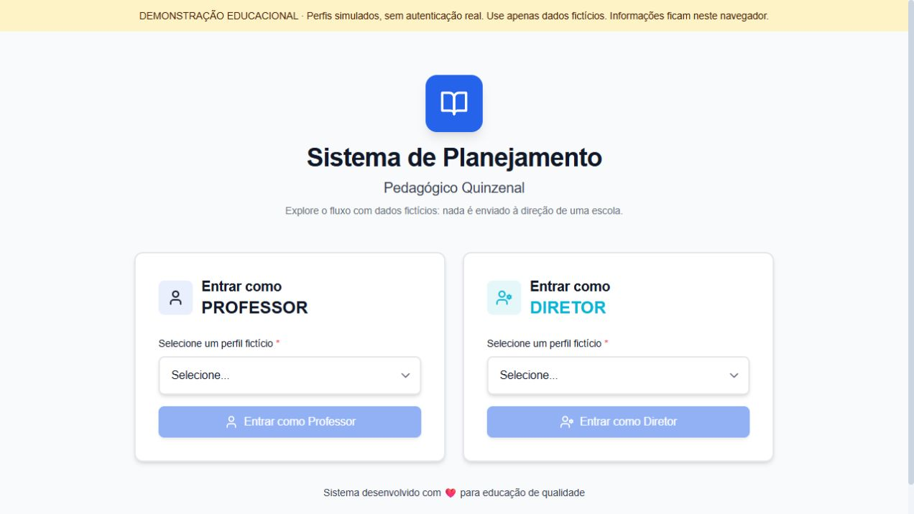
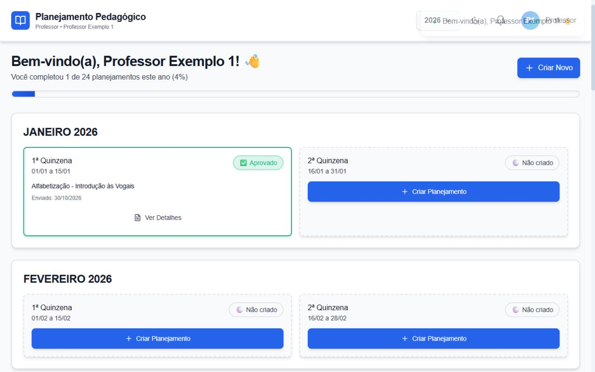
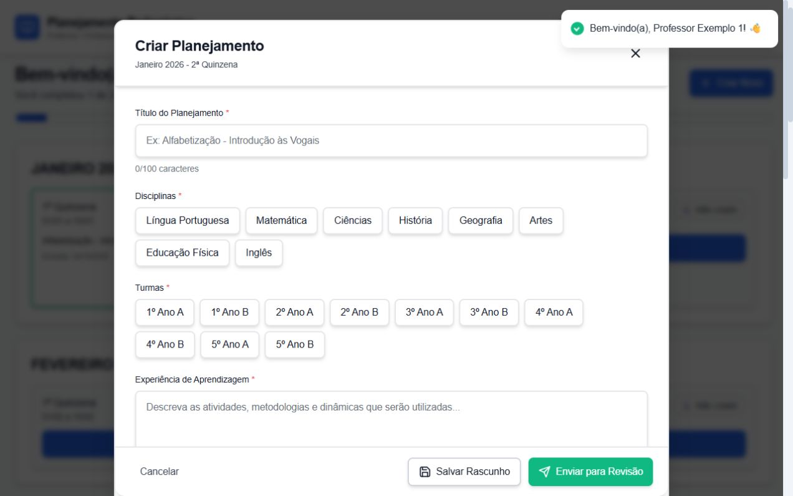
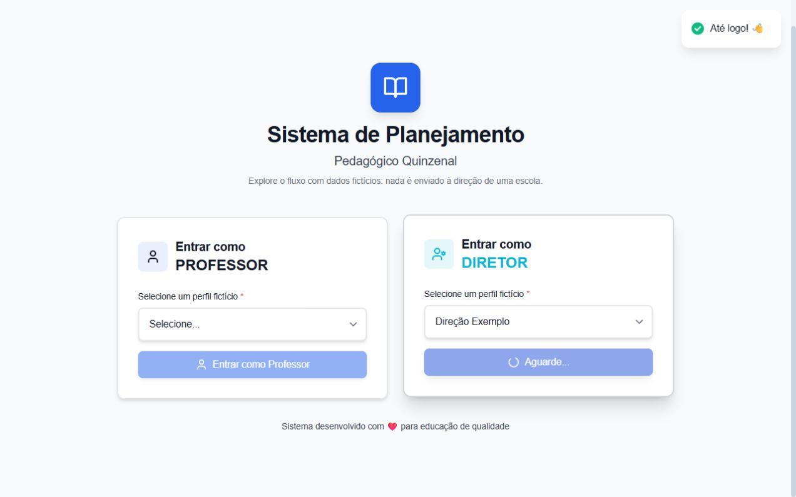
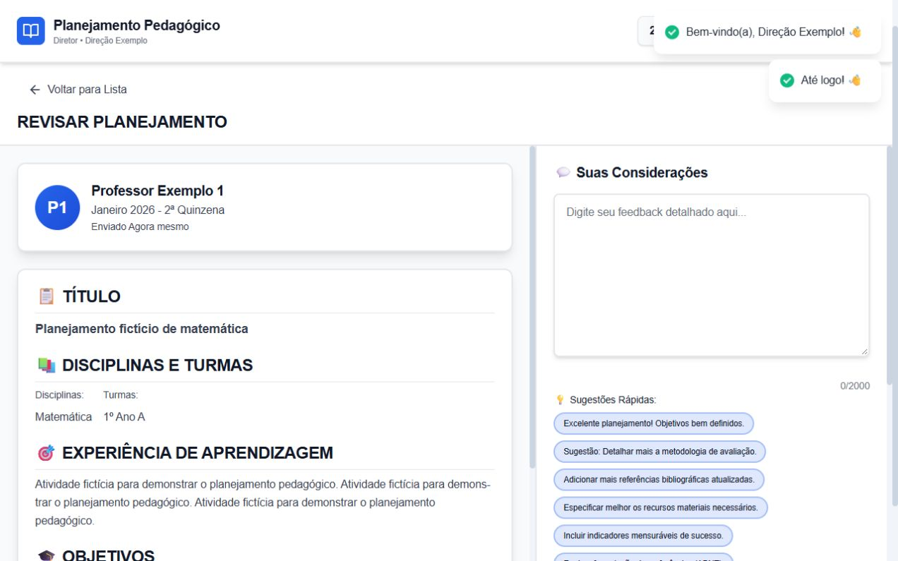
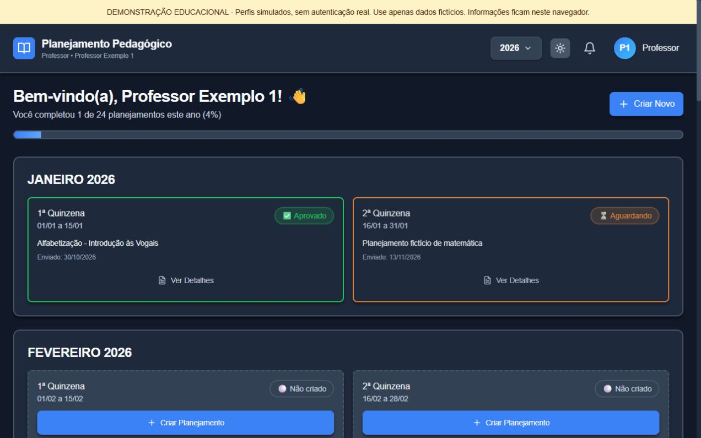

# Planejamento Pedagógico Quinzenal

Uma aplicação web demonstrativa para explorar a organização de planejamentos por quinzena e um fluxo de revisão pedagógica. O projeto nasceu de uma necessidade familiar: tornar mais fácil visualizar o planejamento de uma professora e imaginar como a direção poderia acompanhá-lo.

> **Projeto demonstrativo desenvolvido com assistência de inteligência artificial. Os perfis são simulados, não existe autenticação real e os dados permanecem armazenados no navegador. Não utilizar informações escolares reais.**

Não é um produto em produção. A demonstração funciona em um navegador por vez e não comprova implantação, uso real por uma escola ou resultados mensuráveis.

## Funcionalidades

- Perfis fictícios de professor e direção, selecionados sem senha.
- Calendário anual com 24 quinzenas, status e acompanhamento visual.
- Criação, edição, validação e salvamento local de planejamentos.
- Simulação de envio para revisão, comentários, solicitação de ajustes e aprovação.
- Painel da direção com busca por título e filtros por professor e status.
- Tema claro/escuro, notificações locais e adaptação para telas menores.

As ações de revisão são simulações locais. Não há comunicação entre usuários ou dispositivos.

## Telas da demonstração

Capturas reais da aplicação local com dados fictícios:

| Entrada | Painel do professor |
| --- | --- |
|  |  |

| Formulário | Painel da direção |
| --- | --- |
|  |  |

| Revisão | Modo escuro |
| --- | --- |
|  |  |

## Tecnologias e arquitetura

React 18, TypeScript, Vite, Tailwind CSS, PostCSS, lucide-react e react-hot-toast. A interface é uma aplicação de página única; não há backend, banco de dados, API de IA, agentes ou roteador de páginas.

```text
index.html → main.tsx → App.tsx
                         ├─ componentes de professor e direção
                         ├─ AppContext → planejamentos e sessão simulada
                         ├─ ThemeContext → tema
                         └─ storageHelpers → localStorage do navegador
```

Os perfis, textos e endereços de exemplo são fictícios. As chaves de armazenamento são específicas da demo. Os perfis compartilham os mesmos dados na mesma origem, e as cópias locais não são backup independente.

## Instalação e execução

Requisitos: Node.js 24 e npm. Na pasta do projeto:

```bash
npm ci
npm run dev -- --host 127.0.0.1
```

Abra o endereço exibido no terminal. Para gerar e testar a versão estática:

```bash
npm run build
npm run preview -- --host 127.0.0.1
```

Para experimentar, entre como Professor Exemplo 1, crie um plano em uma quinzena livre, preencha os campos e envie. Saia pelo menu de perfil, entre como Direção Exemplo no mesmo navegador e abra o item pendente. Use somente dados fictícios.

## Testes e limitações

Em 13/11/2026, instalação limpa e build passaram com as verificações do TypeScript ativas; `npm audit` retornou zero alertas conhecidos, resultado pontual que não garante ausência de falhas. Na última rodada foram observados acesso, rascunho, salvamento repetido, recarga, edição, validação, envio e busca. Aprovação e solicitação de ajustes foram verificadas na rodada anterior, documentada em [Relatório de testes e riscos](RELATORIO_TESTES_E_RISCOS.md); a repetição completa de revisão na rodada final ficou limitada por falha na conexão do navegador de teste. Não há suíte automatizada.

LocalStorage pode ser limpo ou ficar indisponível e pode ser acessado por código na mesma origem; não é armazenamento seguro ou compartilhado. Não há senha, permissões reais nem recuperação independente. O checklist de revisão é visual; a persistência dele não foi comprovada. Não houve auditoria completa de acessibilidade, múltiplas abas ou dispositivos.

## Cursor e assistência de IA

Segundo o autor, o projeto original foi desenvolvido com assistência do Cursor para transformar uma necessidade familiar em um protótipo de software. Não há histórico preservado suficiente para atribuir partes específicas do código à IA ou quantificar a participação de cada um. A demonstração foi revisada e preparada posteriormente. Usar IA para auxiliar o desenvolvimento não equivale a integrar uma API de IA: esta aplicação não possui essa integração.

Detalhes das escolhas e limitações estão no [estudo de caso](ESTUDO_DE_CASO.md).

## Publicação futura no Cloudflare Pages

O projeto pode ser publicado como site estático após revisão e autorização. Na integração com GitHub, selecione este repositório, raiz do projeto, Node 24, build `npm run build` e diretório `dist`. Nenhuma variável secreta é necessária. A aplicação usa apenas a página principal e estados React, sem rotas de negócio; não exige regra específica de rotas nesta versão. O Cloudflare Pages trata SPAs conforme sua [documentação React](https://developers.cloudflare.com/pages/framework-guides/deploy-a-react-site/). O armazenamento continuará no navegador do visitante e uma hospedagem não adicionará autenticação.

Não há demonstração online publicada neste momento.
