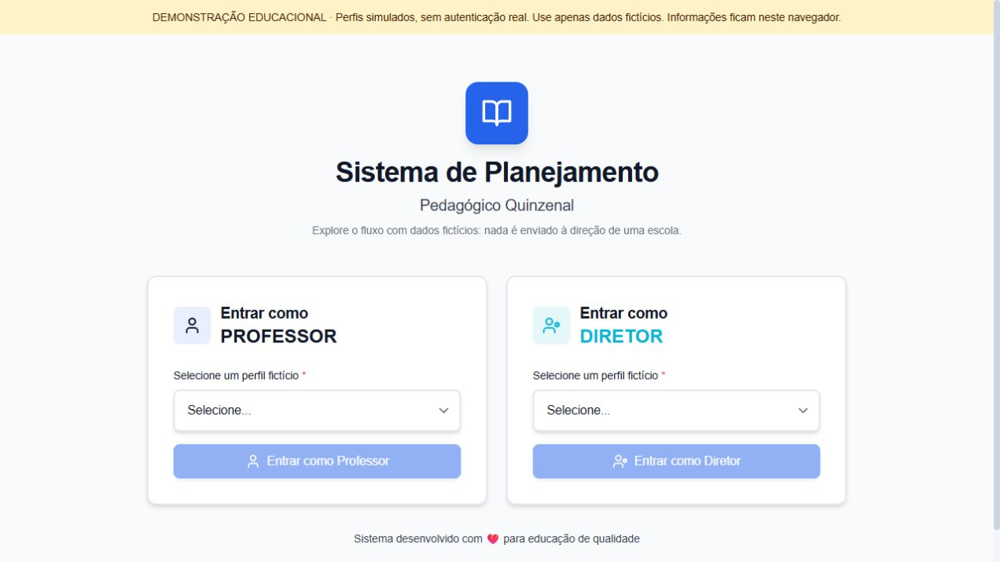
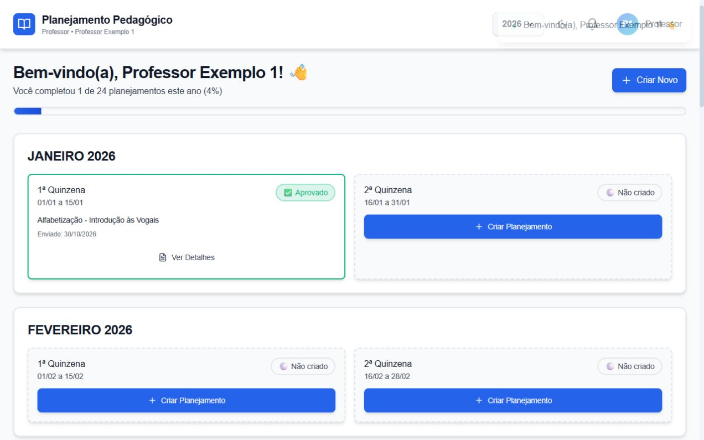
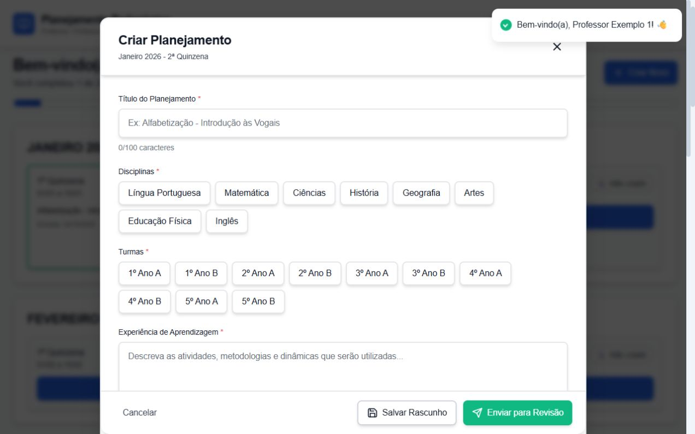
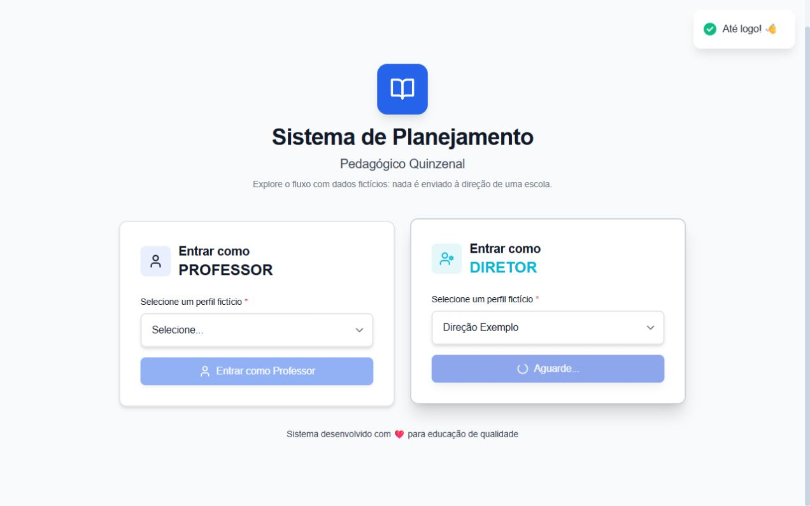
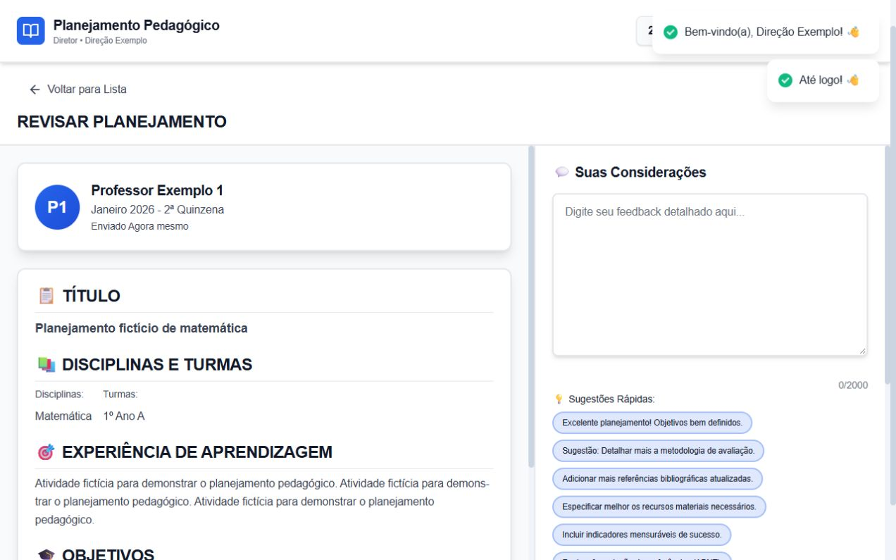
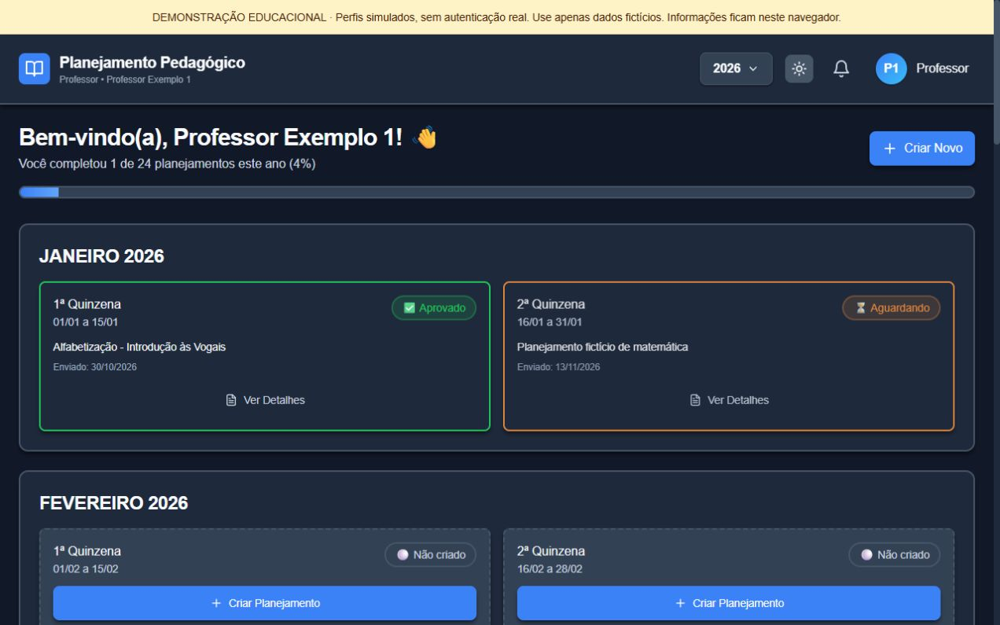

# Planejamento Pedagógico Quinzenal (V2)

Criei este projeto originalmente para explorar uma solução que ajudasse minha mãe a organizar seus planejamentos pedagógicos quinzenais. A partir dessa necessidade próxima da minha realidade, construí a V1 com apoio do Cursor e de inteligência artificial e, nesta V2, evoluí a aplicação para um projeto demonstrativo mais confiável, testável e documentado.

> **Aviso importante:** esta é uma **aplicação demonstrativa local** com perfis fictícios, sem autenticação real, sem banco de dados e sem servidor. Use apenas dados fictícios. As informações ficam armazenadas somente no `localStorage` do mesmo navegador.

## Demonstração online

- **Demonstração pública atual (ainda na V1):** [https://planejamento-pedagogico-web.pages.dev/](https://planejamento-pedagogico-web.pages.dev/)
- O código V2 está neste repositório. A demonstração publicada no Cloudflare Pages continua na **V1**; a V2 ainda não foi implantada.

## Origem, problema e objetivo

Na rotina escolar que motivou a ideia, planejamentos pedagógicos quinzenais costumam ficar espalhados em documentos soltos, dificultando saber quais quinzenas já foram preenchidas, quais aguardam retorno e quais precisaram de ajustes.

O objetivo deste projeto é demonstrar, de forma prática e transparente:

- Organização de planejamentos em um calendário anual de **24 quinzenas** (12 meses × 2 quinzenas).
- Simulação do fluxo completo entre **Professor** e **Direção** no mesmo navegador.
- Regras de negócio explícitas (máquina de estados), validação estruturada, integridade de dados e persistência defensiva em `localStorage`.
- Separação entre lógica de domínio (funções puras) e interface React, com suíte automatizada de testes.

Este projeto **não é** um sistema em produção, **não foi** adotado oficialmente por uma escola, **não** possui integração com APIs de inteligência artificial e **não** deve ser confundido com o projeto *AI Planning Reviewer*.

## Funcionalidades

### Fluxo do Professor (perfis fictícios `Professor Exemplo 1` a `4`)
- Calendário anual com 24 quinzenas e indicadores individuais calculados dinamicamente (Aprovados, Aguardando revisão, Ajustes solicitados, Rascunhos e barra de progresso anual).
- Criação e edição de planejamentos com preenchimento de título, disciplinas, turmas, experiência de aprendizagem, objetivos, recursos (com sugestões rápidas), metodologia, instrumentos, conclusão, referências e observações fictícias.
- Diferenciação entre **salvar rascunho** (permite salvar progresso parcial sem exigir mínimos de envio) e **enviar para revisão** (valida todos os campos obrigatórios e limites de tamanho).
- Proteção contra perda acidental de dados ao fechar o formulário com alterações não salvas.
- Visualização detalhada do planejamento com linha do tempo completa de envios, reenvios, comentários, ajustes e aprovação.
- Correção de planejamentos devolvidos (`ajustes_solicitados`) preservando o feedback da direção até o reenvio explícito.
- Exclusão permitida apenas para rascunhos do próprio perfil.

### Fluxo da Direção (perfil fictício `Direção Exemplo`)
- Indicadores anuais calculados exclusivamente sobre os registros armazenados no ano selecionado (Total, Aguardando revisão, Aprovados com taxa percentual e Ajustes solicitados).
- Busca por título e filtros combinados por professor e status (incluindo visualização de **Todos os status**), com estados vazios claros.
- Tela responsiva de revisão com exibição do conteúdo completo, histórico cronológico, sugestões rápidas, avaliação opcional (1 a 5 estrelas), comentários, solicitação de ajustes (com justificativa obrigatória) e aprovação simulada.
- Bloqueio real de ações incompatíveis com o estado (ex.: rascunhos e planejamentos já aprovados não podem ser aprovados ou devolvidos).

### Interface, temas e acessibilidade
- Modo claro e escuro com tokens CSS semânticos e preferência persistida no navegador.
- Modais com `role="dialog"`, fechamento via tecla `Escape`, diálogos de confirmação próprios (sem `window.alert`/`window.confirm`), rótulos vinculados (`htmlFor`/`id`) e indicador visível de foco (`:focus-visible`).

## Arquitetura resumida

A V2 organiza o código em camadas simples e fáceis de explicar:

```text
src/
├── types/          # Tipos e interfaces TypeScript (domínio, validação e persistência)
├── models/auth/    # Modelo de perfil fictício (Usuario)
├── data/           # Dados demonstrativos fictícios e listas de opções
├── domain/         # Regras puras e testáveis sem React:
│   ├── stateMachine.ts     # Transições permitidas e permissões por perfil/status
│   ├── validation.ts       # Validação de rascunho, envio e feedback da direção
│   ├── planningService.ts  # Operações imutáveis no estado + checagem de integridade
│   └── metrics.ts          # Filtros, ordenação e indicadores calculados
├── persistence/    # Persistência defensiva em localStorage e migração V1 -> V2
├── context/        # AppContext (orquestração de estado) e ThemeContext (tema claro/escuro)
├── utils/          # Helpers de datas quinzenais e wrappers de compatibilidade
└── components/     # Interface dividida por auth, layout, common, professor e diretor
```

Mais detalhes em [ARCHITECTURE.md](ARCHITECTURE.md), [BUSINESS_RULES.md](BUSINESS_RULES.md) e [STATE_TRANSITIONS.md](STATE_TRANSITIONS.md).

## Regras de negócio e estados

O sistema mantém os 4 status reais da V1 sem criar estados artificiais:

| Status | Ações permitidas |
|---|---|
| `rascunho` | Professor dono pode editar, excluir ou enviar para revisão (`aguardando_revisao`). Direção não pode aprovar, devolver ou comentar. |
| `aguardando_revisao` | Bloqueado para edição do professor. Direção pode comentar, solicitar ajustes (`ajustes_solicitados`) ou aprovar (`aprovado`). |
| `ajustes_solicitados` | Professor dono pode salvar correções em andamento (mantendo o status e o feedback da direção) ou reenviar (`aguardando_revisao`). Direção pode registrar comentários, mas não decidir novamente antes do reenvio. |
| `aprovado` | Estado final. Bloqueado para edição do professor e para novas decisões de status; direção pode apenas registrar comentários complementares. |

## Persistência no navegador e compatibilidade V1/V2

- Os dados da V2 são gravados em `demo_pedagogica_v2_state` dentro de um envelope versionado (`schemaVersion: 2`) e o tema em `demo_pedagogica_v2_theme`.
- Ao detectar dados da V1 (`demo_pedagogica_v1_state`), a aplicação migra automaticamente os registros válidos para a V2 sem apagar a chave legada.
- Em caso de **JSON corrompido ou falha de leitura (`storage_unavailable`)**, o sistema ativa o modo proteção: **não sobrescreve** automaticamente o armazenamento local, exibe um alerta com opção para tentar ler novamente (quando indisponível) ou baixar o registro bruto (quando corrompido), e só restaura os exemplos demonstrativos mediante confirmação explícita.
- Na restauração explícita, o novo envelope V2 é gravado e confirmado **antes** da remoção das chaves legadas da V1; se a gravação falhar, os registros existentes permanecem intactos, e se a limpeza posterior falhar, o sistema informa explicitamente a restauração concluída com ressalvas.
- Se a gravação no `localStorage` falhar (ex.: `QuotaExceededError`), a operação retorna erro explícito e **nunca** exibe confirmação falsa de salvamento.
- `localStorage` pertence à origem do navegador, não oferece privacidade entre perfis simulados nem garantia de armazenamento permanente. Consulte [DATA_PERSISTENCE.md](DATA_PERSISTENCE.md) e [SECURITY.md](SECURITY.md).

## Tecnologias utilizadas

- **React 18** e **TypeScript 5** para interface e tipagem estática.
- **Vite 8** para ambiente de desenvolvimento e build estático.
- **Tailwind CSS 3** e **PostCSS** para estilização e temas.
- **Lucide React** para ícones e **React Hot Toast** para notificações locais.
- **LocalStorage** para persistência demonstrativa no navegador.
- **Vitest**, **Testing Library** (`@testing-library/react`, `@testing-library/dom`, `@testing-library/jest-dom`, `@testing-library/user-event`) e **jsdom** para testes automatizados (`devDependencies`).

## Testes automatizados

A V2 introduz uma suíte automatizada cobrindo regras de negócio, máquina de estados, validações, métricas, persistência (incluindo corrupção, falha de gravação e migração V1/V2) e fluxos ponta a ponta da interface.

```bash
npm run typecheck
npm test
npm run build
```

Consulte [TESTING_STRATEGY.md](TESTING_STRATEGY.md) para o escopo dos testes.

## Como executar localmente

Requisito: **Node.js `>=24.15.0`** (linha 24.x — fixado em **`24.22.3`** em [`.node-version`](.node-version), compatível oficialmente com `jsdom@31.0.1`) e **npm**.

```bash
npm ci --ignore-scripts
npm run dev -- --host 127.0.0.1
```

Para validar build de produção e testar localmente:

```bash
npm run typecheck
npm test
npm run build
npm run preview -- --host 127.0.0.1
```

## Capturas de tela

### Capturas históricas da V1 (demonstração pública atual)

As imagens abaixo foram capturadas na **V1** com dados fictícios e são preservadas como registro histórico da versão publicada em `planejamento-pedagogico-web.pages.dev`:

| Entrada (V1) | Painel do professor (V1) |
| --- | --- |
|  |  |

| Formulário (V1) | Seleção da direção (V1) |
| --- | --- |
|  |  |

| Revisão (V1) | Modo escuro (V1) |
| --- | --- |
|  |  |

> **Nota sobre capturas da V2:** durante a preparação desta entrega, a conexão automatizada com o Chrome DevTools não estava disponível no ambiente (`DevToolsActivePort` ausente), portanto **não** foram geradas capturas falsas nem reutilizadas imagens da V1 como se fossem da V2. A validação funcional da V2 foi executada via suíte automatizada (`Vitest` + `Testing Library` + `jsdom`). Capturas reais da V2 podem ser adicionadas em `docs/imagens-v2/` após inspeção visual em navegador local.

## Limitações conhecidas

- Sem autenticação real, autorização no servidor ou controle de acesso seguro.
- Sem banco de dados, backend ou sincronização entre dispositivos ou pessoas.
- Uso simultâneo em múltiplas abas do mesmo navegador pode sobrescrever alterações da aba mais antiga ao gravar no `localStorage`.
- Não há auditoria completa de conformidade WCAG com leitores de tela nem teste em todos os navegadores/dispositivos físicos.
- Não deve receber dados escolares reais, dados pessoais ou informações de estudantes.

## Minha participação e uso de assistência de IA

Sou estudante de Inteligência Artificial e Machine Learning, com base principal em Python, Machine Learning, Pandas, SQL Server, Power BI, FastAPI, Pydantic e Pytest.

- **Minha participação:** identifiquei o problema a partir da rotina da minha mãe, defini os requisitos do fluxo quinzenal (professor e direção), conduzi a priorização de melhorias da V2, revisei os critérios de qualidade e utilizei o projeto como laboratório prático para estudar arquitetura frontend, regras de negócio e testes automatizados.
- **Assistência de IA:** tanto o protótipo original (com apoio do Cursor) quanto a evolução estrutural da V2 contaram com assistência de IA na escrita de código TypeScript/React, estilização Tailwind e configuração de testes.
- **Transparência sobre domínio técnico:** ainda **não** domino autonomamente JavaScript, TypeScript, React, Tailwind CSS, Vite e ferramentas de teste frontend — estas tecnologias estão em processo ativo de estudo.

## Documentação do projeto

### Documentação técnica (V2)
- [ARCHITECTURE.md](ARCHITECTURE.md) — Arquitetura, fluxo de dados e responsabilidades.
- [BUSINESS_RULES.md](BUSINESS_RULES.md) — Regras de negócio e decisões documentadas.
- [STATE_TRANSITIONS.md](STATE_TRANSITIONS.md) — Máquina de estados e matriz de permissões.
- [DATA_PERSISTENCE.md](DATA_PERSISTENCE.md) — Estratégia de `localStorage`, recuperação de erros e migração V1/V2.
- [DATA_DICTIONARY.md](DATA_DICTIONARY.md) — Dicionário completo de entidades e campos.
- [SECURITY.md](SECURITY.md) — Modelo de ameaças, privacidade e limites do ambiente local.
- [TESTING_STRATEGY.md](TESTING_STRATEGY.md) — Estratégia de testes e cobertura comportamental.

### Material de estudo e entrevista

### Documentos históricos preservados (V1)
- [ESTUDO_DE_CASO.md](ESTUDO_DE_CASO.md)
- [RELATORIO_TESTES_E_RISCOS.md](RELATORIO_TESTES_E_RISCOS.md)
- [PUBLICACAO_PORTFOLIO.md](PUBLICACAO_PORTFOLIO.md)
