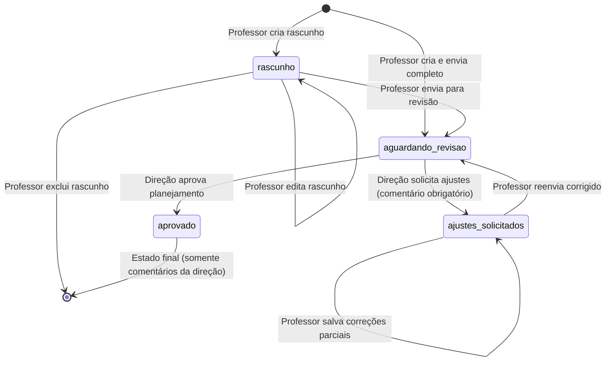

# Máquina de Estados — Planejamento Pedagógico Web V2

Implementação centralizada em [`src/domain/stateMachine.ts`](src/domain/stateMachine.ts) e aplicada por [`src/domain/planningService.ts`](src/domain/planningService.ts).

## 1. Status oficiais preservados da V1

A V2 preserva os **4 status reais** da V1 (`StatusPlanejamento`), evitando estados redundantes e mantendo compatibilidade direta na migração:

1. `rascunho`
2. `aguardando_revisao`
3. `ajustes_solicitados`
4. `aprovado`

O conceito de **reenvio** é rastreado sem criar um quinto status redundante, combinando a transição `ajustes_solicitados -> aguardando_revisao`, o campo `reenviadoEm`, o incremento de `versao` e um evento `tipo: 'reenvio'` em `historicoConsideracoes`.

## 2. Diagrama de transições permitidas

## 3. Matriz completa de transições

| De \ Para | `rascunho` | `aguardando_revisao` | `ajustes_solicitados` | `aprovado` |
|---|---|---|---|---|
| `rascunho` | Sim (Professor dono) | Sim (Professor dono + validação completa) | Não | Não |
| `aguardando_revisao` | Não | Não | Sim (Direção + comentário obrigatório) | Sim (Direção) |
| `ajustes_solicitados` | Não | Sim (Professor dono + validação completa) | Sim (Professor dono salvando correção) | Não |
| `aprovado` | Não | Não | Não | Não |

## 4. Matriz de ações por perfil e status

| Ação | `rascunho` | `aguardando_revisao` | `ajustes_solicitados` | `aprovado` |
|---|---|---|---|---|
| Editar conteúdo | Professor dono | Bloqueado | Professor dono | Bloqueado |
| Excluir registro | Professor dono | Bloqueado | Bloqueado | Bloqueado |
| Enviar / Reenviar | Professor dono | Bloqueado | Professor dono | Bloqueado |
| Aprovar | Bloqueado | Direção | Bloqueado | Bloqueado |
| Solicitar ajustes | Bloqueado | Direção | Bloqueado | Bloqueado |
| Registrar comentário | Bloqueado | Direção | Direção | Direção |

## 5. Proteções contra inconsistências

- **Aprovação de rascunho:** rejeitada em `podeRevisarPlanejamento` e `aprovarPlanejamento`.
- **Edição após aprovação ou durante revisão:** rejeitada em `podeEditarPlanejamento` e `salvarRascunho`.
- **Repetição acidental de aprovação ou solicitação de ajustes:** como o status muda imediatamente de `aguardando_revisao` para `aprovado` ou `ajustes_solicitados` e `AppContext` lê `estadoRef.current`, uma segunda chamada imediata é rejeitada pelo domínio.
- **Rebaixamento indevido de `ajustes_solicitados` para `rascunho`:** corrigido em `salvarRascunho`, que mantém `status: 'ajustes_solicitados'` e preserva `consideracoesDiretor`, `avaliacaoDiretor`, `prazoAjustes` e `historicoConsideracoes`.
